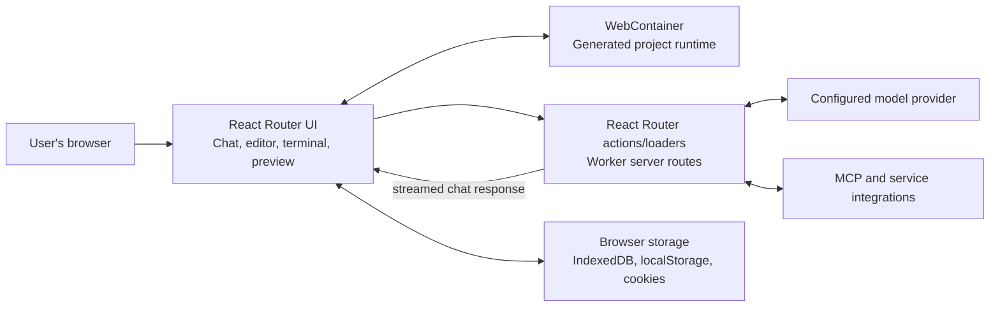

# bolt.diy architecture

bolt.diy is a browser-based AI development workspace. The web application coordinates chat, model requests, project files, and integrations; generated application code runs in a WebContainer in the user's browser.

## System overview

## Application and server

The interface is built with React and React Router. `app/routes.ts` defines the application routes, and `app/components/` contains the chat, workbench, settings, and shared UI. The main route combines the chat UI with the client-side workbench.

The server entry point is `workers/app.ts`. It passes incoming requests and the Cloudflare Worker environment to React Router. Route modules under `app/routes/` provide page loaders/actions and API endpoints. For example, `app/routes/api.chat.ts` validates chat requests, reads provider credentials and settings, coordinates context and tool calls, and streams model output back to the browser. Provider implementations and model selection live under `app/lib/modules/llm/`.

## Project runtime and persistence

The WebContainer is initialized on the client in `app/lib/webcontainer/`. It provides the project filesystem, terminal processes, development server, and preview for the generated application inside the browser. It is separate from the Worker that serves bolt.diy itself.

Chat history and snapshots use browser IndexedDB through `app/lib/persistence/`. Other preferences and integration settings use browser storage such as `localStorage` and cookies. This is local to the browser profile; the application does not provide account-based project synchronization or a shared project database.

## Model and tool integrations

Provider classes are registered in `app/lib/modules/llm/registry.ts`. A user can select a configured provider and model for chat. Credentials can come from server environment variables or from settings saved in browser cookies and sent with requests.

Chat can also use selected MCP tools, project tools, and configured service integrations. MCP server connections are managed by `app/lib/services/mcpService.ts`; chat request orchestration is in `app/routes/api.chat.ts`. Integrations such as GitHub, Supabase, and deployment providers have their own route modules and browser-side stores.

## Build and deployment

Vite builds the React Router application for the Cloudflare Workers runtime. `workers/app.ts` is the production Worker entry point, configured by `wrangler.jsonc`. The Dockerfile provides development and production image targets; Electron packages the renderer and desktop main/preload processes for desktop use.

For package scripts and local setup, see the [README](README.md). The application source is organized primarily under `app/`, with the Worker entry point in `workers/` and desktop code in `electron/`.
